The [WireGuard usermod](https://github.com/wled/WLED/tree/main/usermods/wireguard) lets a WLED device join a [WireGuard](https://www.wireguard.com/) VPN by itself. WLED connects out to your WireGuard server, so any phone or computer on that VPN can reach the device from anywhere, without opening a port to WLED.

Every device you want on the VPN needs the usermod build, its own key pair and its own peer entry on the server. The same build works on all of them. If you'd rather reach every device at home at once, run a VPN on your router or a home server instead. [Accessing WLED over Internet](/advanced/access-over-internet) covers the options.

!!! warning "Anyone who can reach the device can control it and read its private key"
    - **Anyone on your VPN can control the device.** WLED has no login, so only add peers you trust. Turning on [OTA Lock](/advanced/ota-lock) is still a good idea.
    - **The private key isn't protected.** It's stored in plain text in the device config. Anyone who can reach the device can download it from `/json/cfg`, even with a settings PIN set. Use a key pair only for this device, and remove its peer from the server if the device is lost, sold or re-flashed.

## Requirements

- An ESP32 board. The usermod doesn't build for ESP8266.
- A WireGuard server that the device can reach, with a free address on its VPN for the device.
- A custom WLED build, see [Building the Firmware](#building-the-firmware) below. The release builds don't include this usermod.
- A working NTP server, since the tunnel only starts once the device knows the correct time.

## Building the Firmware

Add `wireguard` to `custom_usermods` as shown in [Compiling WLED](/advanced/compiling-wled#adding-usermods). To keep the usermods your base environment already has (`esp32dev` includes AudioReactive), inherit its list:

```ini
[env:esp32dev_wireguard]
extends = env:esp32dev
custom_usermods =
  ${env:esp32dev.custom_usermods}
  wireguard
```

Every future firmware update for the device has to be a build with the usermod too, or the device drops off the VPN.

## Server Setup

The device needs its own key pair, and your server needs a peer entry for it with the device's public key and its VPN address as a `/32`. The [WireGuard quick start](https://www.wireguard.com/quickstart/) shows how to make keys and add a peer. To reach the device from your phone, the server must also pass traffic between its peers.

Make sure the server allows internet access for the device. (1)
{ .annotate }

1.  The tunnel becomes the device's default route. Devices on the same Wi-Fi network are still reached directly, but things like an MQTT broker on the internet or the NTP server go through your WireGuard server, and may be unreachable if the tunnel isn't working.

## WLED Settings

After flashing, open **Config > Usermods** and fill in the WireGuard section:

| Field | What to enter |
|---|---|
| Server Hostname | Your WireGuard server's public hostname or IP |
| Server Port | The server's WireGuard port, usually `51820` |
| Device IP | The address you picked for this device on the VPN, e.g. `10.8.0.5` |
| Pre Shared Key (optional) | Only if your server's peer entry uses one |
| Private Key | The device's private key |
| Public Key | Your **server's** public key, not the device's |
| POSIX timezone string | `UTC0` works anywhere. The usermod only needs the clock to be right |

Fill in every field except the pre-shared key, tick **Reboot after save?**, then save. Do the same whenever you change the settings later. (1)
{ .annotate }

1.  The usermod connects with whatever is there, even empty fields. The reboot applies the timezone and restarts a running tunnel, which otherwise keeps its old settings.

The usermod syncs the clock itself, using the server in the box under **Get time from NTP server** in **Config > Time & Macros** (`0.wled.pool.ntp.org` by default).

## Troubleshooting

Start with the WireGuard line in the **Info** panel:

```mermaid
flowchart TD
    A[Open the Info panel] --> B{What does the WireGuard line say?}
    B -->|Time out of sync!| C[Check the device can reach the NTP server]
    B -->|netif down :&#40;| D[Check the server hostname and private key]
    B -->|netif up!| E{Does the device's VPN address open from your phone?}
    B -->|No WireGuard line| F[Check the build includes the usermod and the settings are saved]
    E -->|Yes| G[It's working]
    E -->|No| H[Check the server's public key and port, then run wg show on the server]
```



"netif up!" only means the tunnel started on the device. It doesn't prove the server answered, which is why the last check is from your phone.

### Common Issues

- **Effects freeze every few seconds.** The server hostname can't be looked up. Each try blocks WLED for 10 seconds or more, and it retries every 5 seconds until the hostname works.
- **Your phone is on the VPN but can't open the device.** The server isn't passing traffic between its peers, or your phone's WireGuard config doesn't include the device's VPN address.
- **MQTT or the time stopped working after enabling the usermod.** Internet traffic now goes through your WireGuard server, so the server has to allow internet access for the device.
- **You changed a setting and nothing happened.** A running tunnel keeps its old settings until you reboot.
- **The device dropped off the VPN after an update.** The new firmware wasn't built with the usermod.

Once connected, the device sends a keepalive at least every 25 seconds, so the tunnel stays open behind a home router.
